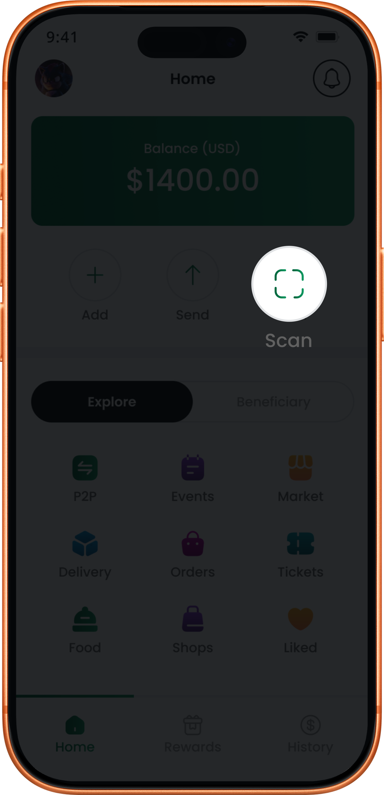

# Scan to Pay

Use **Scan to Pay** to make a QR code payment in Greep Pay.

This flow helps you pay a merchant or another user by scanning their QR code.


Scan to Pay is useful for **in-person payments**, **merchant payments**, and **user-to-user QR code payments**.


### How to use Scan to Pay



<figure><figcaption></figcaption></figure>



<figure><figcaption></figcaption></figure>





### Open the QR scanner

From the home screen, tap **Scan**.

Grant camera permission if prompted.



### Scan the QR code

Point your camera at the merchant or recipient QR code.

The app detects the code automatically when it is clear and in view.



### Review the payment details

The recipient details appear after the QR code is scanned.

Verify the amount, or enter the amount if it is not already filled.



### Confirm the QR payment

Tap **Pay** or **Continue**.

Enter your **Transaction PIN** to complete the payment.



### Check the payment confirmation

You get instant confirmation when the payment succeeds.

Both you and the recipient receive a notification.



### When to use Scan to Pay

Use Scan to Pay when you want to:

* pay with a QR code at a merchant location
* pay another user in person
* complete a fast contactless payment in the app

### What happens next

After the QR code payment succeeds, the transaction appears in your history.

If you want someone to pay you instead, read [Receiving Money](receiving-money.md).
