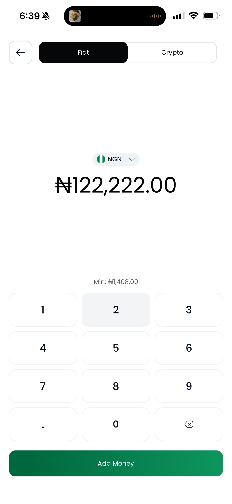
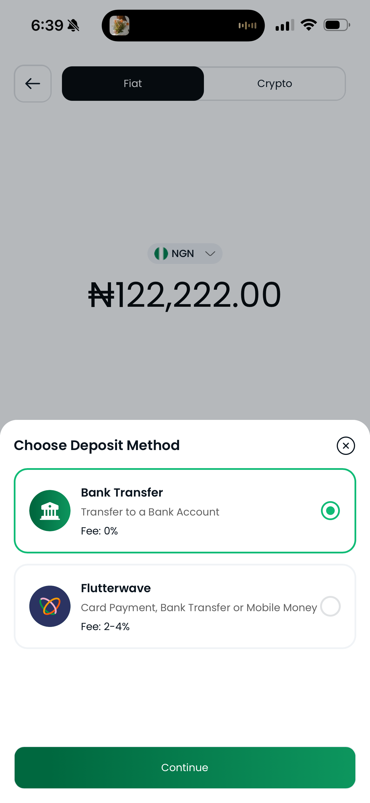
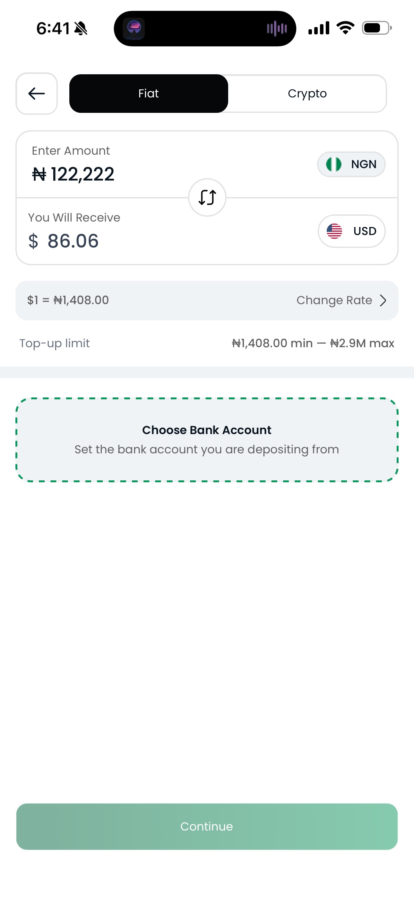
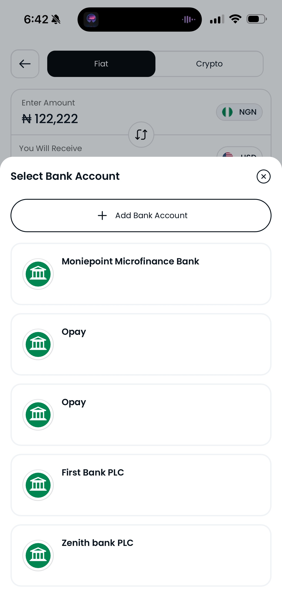
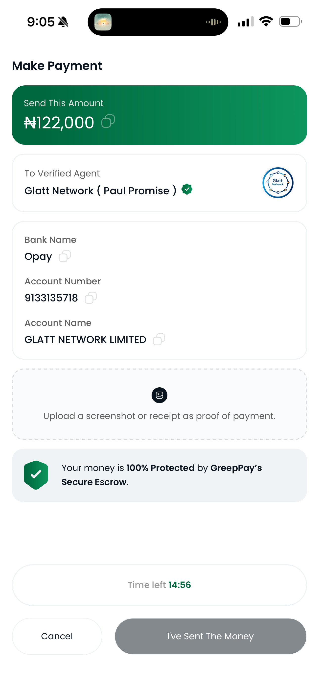

# How to Fund Your Wallet with P2P

Use this flow to add **fiat currency**, such as **NGN**, to your wallet from the **Fiat** tab.

Start from the **Home** screen and tap **"Fund"** on your wallet card.



#### Step 1: Enter the amount

* Tap **"Fund"** on your wallet card.
* Stay on the **Fiat** tab.
* Select **NGN** as your funding currency.
* Enter the amount you want to add.
* Tap **"Add Money"**.

#### Step 2: Choose a deposit method

* Select **Bank Transfer** or another available option, such as **Flutterwave**.
* Review the fee for your selected method.
* Tap **"Continue"**.



<figure><figcaption></figcaption></figure>



<figure><figcaption></figcaption></figure>





<figure><figcaption></figcaption></figure>



#### Step 3: Review the funding details

* Check the **NGN** amount you entered.
* Review the amount you will receive in your wallet.
* Confirm the displayed rate and top-up limit.
* Use **"Change Rate"** if needed.





#### Step 4: Choose your bank account

* Tap **"Choose Bank Account"**.
* Select the bank account you are depositing from.
* Tap **"Add Bank Account"** if your account is not listed.
* Tap **"Continue"** to move to payment.



<figure><figcaption></figcaption></figure>





#### Step 5: Make the payment

* Review the payment page carefully.
* Confirm that you are sending money to the listed **verified agent**.
* Copy the bank name, account number, and account name shown.
* Transfer the exact amount displayed on the screen.
* Upload a screenshot or receipt as proof of payment if prompted.
* Tap **"I've Sent The Money"** after you complete the transfer.

#### Step 6: Wait for confirmation

* Your payment is protected by GreepPay's **Secure Escrow** during confirmation.
* Keep an eye on the countdown timer and complete payment before it expires.
* Wait while the agent verifies your transfer.
* Once confirmed, the funds appear in your wallet balance.



<figure><figcaption></figcaption></figure>




Use the exact payment details shown on the payment screen.

Do not change the amount or send to a different account.



Only send payment to the verified agent shown on the payment page.

If the timer expires before payment is confirmed, start the transaction again.



Rates, limits, and fees can change by currency and funding method.

Always review the final amount before you continue.

