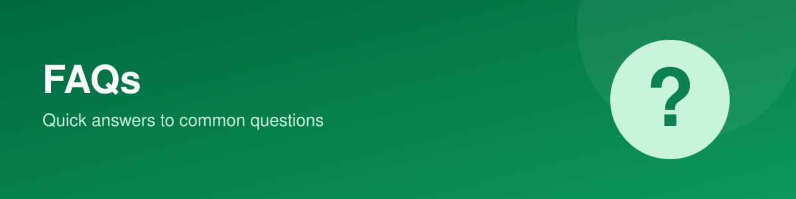

# Frequently Asked Questions

Find quick answers to common questions about Greep Pay for business.

Use this page for product basics, getting paid, selling online, and account rules.

**Related terms:** Greep Pay, Business Dashboard, Bank Transfer, Payment Links, Invoices, Wallet, Storefront, Savings, Security

### Getting started

What is Greep Pay for business?

A dashboard where you get paid, sell online and manage your money in one place.

How do I change my business name, email or bio?

Open Settings, then Business Profile, and press Edit.

How do I hide tools I don't use?

Open Settings, then Tools, untick the ones you don't want and press Save Changes.

Why do some features say "Coming Soon"?

They aren't available yet. We don't have dates to share, and they appear in your dashboard when they're ready.

### Getting paid

How do my customers pay me by bank transfer?

Open Accounts, choose the currency, and share the details shown. Ask your customer to copy every detail exactly as shown, including the reference if one is listed.

Which currencies can I receive by bank transfer?

Nigerian naira (NGN), US dollars (USD) and euros (EUR). The United Kingdom (GBP) account is coming soon.

Why isn't the account holder name on my euro or dollar account my business name?

That is how these accounts are shown, and it is normal. Ask your customer to copy the details exactly as they appear.

My customer paid but I don't see it. What should I do?

Check Wallet, then Transaction History (clear the filters), and the Settlements tab. Ask your customer to confirm they used the exact details, including the reference if one is listed. If it still isn't there, send us your business email, the amount and currency, the date and time, the sender's name and bank, the reference used and a screenshot of the receipt.

Can I get paid without sharing bank details?

Yes. Create a payment link, or send an invoice.

How do I create a payment link?

Open Payment Links, then Create New Link. Choose the currency and amount, name the link and press Generate Link.

Can I make a payment link stop working after a certain time?

Yes. Turn on Link Expiration when you create it, and set a date and time.

How do I create and send an invoice?

Open Invoices, then Create Invoice. Fill in the client and line items, press Save, then email it to your client or download the PDF.

Why can't I email or download my invoice?

The invoice has to be saved first. Press Save, then try again.

How can my client pay an invoice?

By card, bank transfer, GreepPay wallet or crypto.

Where does the money from a naira invoice go?

Into your GreepPay NGN wallet.

### Selling online

How do I add a product?

Open Products, then Add Product. The product name, description and category are required. At any step you can Save as Draft or Publish Product.

What is the difference between a draft and a published product?

A draft is not shown to customers until you publish it.

How do I set up my online shop?

Open Storefront, add a cover photo, store name and description, and press Save. Your shop's link is at the bottom of the page.

How do I turn on shipping?

Open Storefront, then the Shipping tab. You need at least one validated pickup address. Auto Shipping is off until you switch it on.

Can I connect my WooCommerce store?

Yes. Open Settings, then Integrations, and press Connect next to WooCommerce. Shopify is coming soon.

How do I make a Link-in-bio page?

Open Link-in-bio, choose a page address, add your logo, name and links, then press Save changes and share the link.

How do I shorten a link and see how many people click it?

Open Link Shortener, then Shorten New Link. The page shows your total clicks, unique visitors and active links.

### Your money

Where can I see my balance?

In Wallet. It shows your ledger balance, available balance, pending balance and total transactions.

How do I see or export my transactions?

Open Wallet, then Transaction History. Filter by type or status, and press Export.

How do savings pots work?

You create a pot under Savings. Flex lets you withdraw anytime, Goal is for saving towards an amount, and Vault locks the funds for a time.

How do I set my exchange rates?

Open Exchange Rates and press Add Currency Pair.

### Account and security

How do I change my password or transaction PIN?

Open Settings, then Account Profile. Under Security, press Edit next to Change Password or Change Transaction PIN.

Will Greep Pay ever ask for my password, PIN or secret key?

Never. Don't share them with anyone, including our support team.

Where are my API keys?

Open Settings, then API Keys. There is a Test Mode and a Live Mode. Pressing Roll Key replaces your secret key and deactivates the previous one. For Live Mode you will need to verify with an OTP code sent to your business email.

How do I choose which alerts I get?

Open Settings, then Notifications. Choose the updates you want and the channels: email, SMS or push.

How do I contact support?

Press Help in your dashboard.

