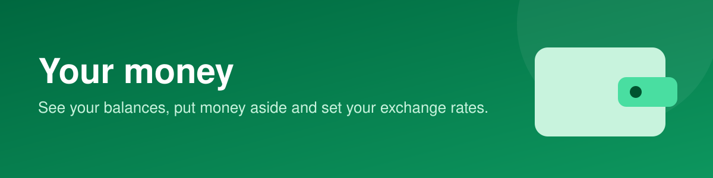

# Your money

See your balances, put money aside and set your exchange rates.

## In this section

- [**Your wallet**](your-wallet.md): Your balances, transaction history and settlements in one place.
- [**Savings: Flex, Goal and Vault pots**](savings-flex-goal-and-vault-pots.md): Put money aside in a savings pot.
- [**Exchange rates**](exchange-rates.md): Set the buy and sell rates you offer.
